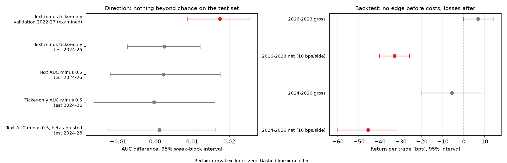

# Market-Moving Event Predictor


Can information around an S&P 500 earnings release predict the stock's reaction? One event table,
three questions: the **direction** of the abnormal return, its **signed size**, and the
**size of the move** regardless of sign.

**Status: v1 complete.** The evaluation plan was frozen in `docs/frozen_plan.md` before the test
period (2024-2026) was scored. Result: no detectable signal. See "Final test-set results" below.



*Left: the validation-period text edge (top row) did not replicate on the 2024-2026 test set. Right: no gross edge in the backtest, and losses after costs. Values are copied from `docs/test_results.txt` and `docs/backtest_results.txt`.*

## Data

| Source | What | How |
|---|---|---|
| Wikipedia | Current S&P 500 constituents | `mep.data.prices` |
| Yahoo Finance (`yfinance`) | Daily adjusted prices from 2015, plus SPY as the market benchmark | `mep.data.prices` |
| SEC EDGAR | 8-K filings with Item 2.02 (earnings results), with acceptance timestamps | `mep.data.events` |
| SEC EDGAR | Press-release exhibits (EX-99) for each filing | `scripts/fetch_press_releases.py` |

Each event is the latest Item 2.02 8-K filed between a fiscal period's end and 3 days after that
period's 10-Q/10-K: one event per reported quarter, mid-quarter guidance updates dropped.
Final table: 20,003 events across 498 tickers. Press-release text exists for 19,829 of 19,891
unique filings (62 had no exhibit).

## Method

- **Abnormal return** = stock return minus SPY return over the same window.
- **Timing rule (no lookahead).** Features use prices through the close before the filing day.
  Filed before 4pm ET: prior close to same-day close. At or after 4pm ET: prior close to next
  trading day's close. Weekend/holiday filings roll to the next trading day. Conservative, since
  filing time is an upper bound on release time.
- **Targets:** `y_dir` (abnormal return > 0), `abn_ret` (signed), `y_abs` (absolute size).
- **Filters:** ECHO excluded (no earnings 8-Ks since 2017); ticker-years with under 3 events
  dropped; events with under 252 trading days of prior prices dropped.
- **Split by date, never random:** train 2016-2021, validation 2022-2023, test 2024-2026 (scored once at the end, with models retrained on 2016-2023; see below).
- **Baselines:** always "up"; training mean; a company's own past average absolute move
  (earlier events only).
- **Price features:** momentum, volatility, volume, distance from 52-week high, SPY context,
  company history from prior events only.
- **Text features:** TF-IDF word and word-pair weights, vocabulary fit on training years only,
  digits masked, logistic regression (direction) and ridge on the baseline's residual (size).
- **Controls:** a ticker-only model, to separate "what the release says" from "which company it is".
- **Uncertainty:** week-level block bootstrap (many companies report in the same week);
  walk-forward evaluation by year, retraining on earlier years only.
- **Tests:** 13 tests cover the timing rule, a no-lookahead check on every rolling price feature
  and on the beta estimate, the bootstrap, and the backtest trade math and costs.

## Results (validation data, no test-set use)

Baselines (2022-2023): always-up accuracy 0.534, log-loss 0.6913; company-history size
baseline MAE 0.0276, R2 0.154.

**Price features** vs baselines, 95% week-block intervals:

| Comparison | Result | 95% interval |
|---|---|---|
| Direction AUC minus 0.5 | +0.0055 | [-0.014, +0.024] |
| Direction log-loss, model minus baseline | +0.0002 | [-0.0013, +0.0017] |
| Size MAE, model minus baseline | +0.0002 | [-0.0003, +0.0007] |

No detectable information beyond the baselines.

**Press-release text**, settings fixed before the full run (2022-2023):

| Comparison | Result | 95% interval |
|---|---|---|
| Direction AUC minus 0.5 | +0.0188 | [+0.0005, +0.0382] |
| Direction log-loss, model minus baseline | -0.0000 | [-0.0021, +0.0019] |
| Size MAE, model minus baseline | +0.0000 | [-0.0001, +0.0002] |
| Ticker-only AUC minus 0.5 (control) | +0.0013 | [-0.0179, +0.0212] |
| Text minus ticker-only, paired AUC | +0.0175 | [+0.0088, +0.0256] |

**Walk-forward by year** (train on earlier years only), direction AUC:

| Year | Text | Ticker-only |
|---|---|---|
| 2019 | 0.520 | 0.527 |
| 2020 | 0.546 | 0.543 |
| 2021 | 0.529 | 0.520 |
| 2022 | 0.514 | 0.497 |
| 2023 | 0.527 | 0.507 |

Averages: in 2019-2021 (not used to choose any settings) text AUC minus 0.5 is +0.0315
[+0.018, +0.044], but text minus ticker-only is +0.0014 [-0.007, +0.010]. In 2022-2023
(already examined) text minus ticker-only is +0.0184 [+0.008, +0.028].

**Validation-period conclusion (before the test set):**
- Text ranks direction slightly better than chance in every year (AUC about 0.51 to 0.55), but
  it cannot be turned into better probabilities (log-loss does not improve).
- In the years not used for model selection, a model that sees only the ticker does equally
  well, so the ranking power is attributable to company identity, not language.
- Text adds nothing for the size of the move.
- Any extra signal from language beyond identity is at most about 0.01 AUC in the fresh years,
  and is only clearly positive in the period already examined.

## Final test-set results (2024-2026, scored once)

The plan in `docs/frozen_plan.md` was committed before scoring (see the commit history). Models were
trained on 2016-2023 and scored on 5,392 test events across 140 weeks. Full report: `docs/test_results.txt`.

| Comparison | Result | 95% interval |
|---|---|---|
| Direction: text AUC minus 0.5 | +0.0022 | [-0.012, +0.018] |
| Direction: ticker-only AUC minus 0.5 | -0.0003 | [-0.017, +0.016] |
| Direction: text minus ticker-only (paired) | +0.0025 | [-0.007, +0.012] |
| Direction: log-loss, text minus always-up | +0.0021 | [+0.0003, +0.0037] |
| Size of move: MAE, baseline+text minus baseline | +0.0001 | [-0.0000, +0.0002] |
| Signed size: R2 of the training mean | -0.0004 | |
| Direction, beta-adjusted target: text AUC minus 0.5 | +0.0012 | [-0.013, +0.016] |

The pre-registered success criterion (text AUC interval above 0.5 **and** above the ticker-only control)
was not met. The text model's probabilities are slightly worse than always predicting "up".

**Conclusion:** neither price history nor earnings-release text predicted the direction or the
size of the reaction beyond simple baselines. The small text effect seen on the 2022-2023 validation
period did not replicate out of sample, consistent with a validation-period artifact (not proven).
The interval allows an effect of up to about 0.018 AUC, which is too small to use, and this is
one test period.

## Backtest (pre-registered, scored once)

The rule and costs were fixed in `docs/frozen_backtest_plan.md` before any backtest ran. The rule has no
fitted parameters: take the sign of the reaction-window abnormal return, go long (or short) the stock
against SPY at the window's closing price, and exit 5 trading days later. Costs: 10 basis points per
side on each of four fills (40 bps round trip), with 0 and 5 bps also reported. Full report:
`docs/backtest_results.txt`.

| Period | Gross per trade | Net at 10 bps per side | Pre-registered criterion |
|---|---|---|---|
| 2016-2023 (14,609 trades) | +6.9 bps [-0.2, +14.1] | -33.1 bps [-40.2, -25.9] | Not profitable |
| 2024-2026 (5,391 trades, second look) | -5.6 bps [-20.3, +8.7] | -45.6 bps [-60.3, -31.3] | Not profitable |

Intervals are 95% week-block bootstrap intervals. The 2024-2026 period had already been scored once for
the direction and size models, so it is a second look and not a clean test.

**Conclusion:** the gross edge is indistinguishable from zero, and after realistic costs the strategy loses
money in both periods. This is evidence about one simple rule, one holding period and a flat cost model
(no slippage, borrow cost or market impact), not about all possible strategies. Weekly-cohort Sharpe and
drawdown figures (about -2.1 Sharpe) are rough because the cohorts ignore overlapping holding periods.

## Known limitations

- **Survivorship bias:** the universe is today's S&P 500.
- **Yahoo Finance data is free but unofficial.**
- **Filing time is an upper bound on release time.** About 44% of events use a 2-day window, which
  adds a day of noise (2-day moves are about 30% larger on average).
- **Companies that changed legal entities** (e.g. XOM, BLK, BG) have short histories under their
  current SEC ID and are mostly excluded.
- **Abnormal return is simple** (stock minus SPY). A beta-adjusted target (each stock's beta from its prior 252 trading days, shrunk toward 1) was tested as a robustness check and changed almost nothing: the ticker-only AUC minus 0.5 in 2019-2021 went from +0.030 to +0.029. So market sensitivity does not explain why company identity predicted direction in those years. The cause is untested; survivorship bias in the stock universe is one possibility.
- **Press releases still contain company names, executive names and contact details**, which a
  text model can use to identify the company. The ticker-only control addresses this only partly,
  and sector vocabulary is not separated from language.
- **Reaction prediction, not a forecast:** releases appear on the filing day, after the window's
  starting price. A trading strategy would need to enter after the release.
- **Selection effects:** several comparisons were run on the 2022-2023 validation period, so
  those intervals are somewhat optimistic. Week-block intervals assume independent weeks.
- **The test set was used once** for the frozen direction and size evaluation. No model was changed after seeing it. 
- **The backtest is one rule.** It tests whether the reaction continues, not a model-driven signal, since no model showed signal. It    ignores slippage, borrow costs and capacity.
- **One test period (2024-2026).** The result says nothing about other market conditions.

## Reproduce

Requires [uv](https://docs.astral.sh/uv/) and a `.env` file containing
`SEC_USER_AGENT="Your Name your.email@example.com"` (SEC requires it).
Create it with: `echo 'SEC_USER_AGENT="Your Name your.email@example.com"' > .env`

```
uv sync
uv run python -m mep.data.prices
uv run python -m mep.data.events
uv run python -m mep.data.event_table
uv run python -m mep.features.price_features
uv run python -m mep.features.beta
uv run python scripts/fetch_press_releases.py     # about 4 hours, resumable
uv run python -m mep.models.baselines
uv run python -m mep.models.first_models
uv run python scripts/uncertainty_check.py
uv run python -m mep.models.text_baseline
uv run python scripts/text_uncertainty.py
uv run python scripts/identity_control.py
uv run python scripts/walk_forward.py
uv run python scripts/walk_forward_beta.py
uv run python scripts/final_test.py dry    # practice mode; the real run refuses to repeat
uv run python scripts/backtest.py dry     # practice mode; the real run refuses to repeat
uv run python scripts/make_chart.py
uv run pytest
```